  

  

  
  
  

### `01` &nbsp;whoami

### `02` &nbsp;my tech in orbit

### `03` &nbsp;things I've built

<b>🔍 Open the project notes</b>

 

| | Project | What it is |
|:--:|:--|:--|
| 🐾 | **Paw Pulse** | Final-year project at OSTRIX: a multi-tenant SaaS platform for veterinary clinics |
| 🚌 | **Pillar API** | Middleware connecting the State with private transport operators (compliance portal, secure API, SaaS suite) |
| 🛠️ | **FabLab** | French desktop app to check lab members in and out in one click, stored locally and synced to Neon PostgreSQL |
| ⛽ | **Fueltracker** | Mobile app to track fuel, built with React Native and Expo |
| 🧱 | **BuildCom** | Landing page I developed for BuildCom, the ISITCom development club (Next.js + Framer Motion) |
| 🦾 | **H.A.M.A** | Hybrid AI Mechanical Assistant: an IoT robotic arm for manufacturing |
| 🛵 | **Delivery platform** | Delivery management platform built during my internship at Innovibe |
| 🪰 | **Khommej** | Asymmetric multiplayer game design: flies vs. a very annoyed human |

### `04` &nbsp;the journey so far

### `05` &nbsp;fun fact

### `06` &nbsp;stats

  

### `07` &nbsp;pick a door

Each link opens an email that's already written for you:

| | |
|:--:|:--|
| 🤝 | [**Collaborate on a MERN / Next.js project**](mailto:hedirziga@gmail.com?subject=Let's%20build%20something%20together) |
| 🎨 | [**Design + build a UI with me**](mailto:hedirziga@gmail.com?subject=UI%20design%20%2B%20dev%20project) |
| 💼 | [**Talk about an internship or a role**](mailto:hedirziga@gmail.com?subject=Opportunity%20for%20Abdelhedi) |
| 🐧 | [**Argue with me about Linux distros**](mailto:hedirziga@gmail.com?subject=About%20Arch...) |

 

  <picture>
    <source media="(prefers-color-scheme: dark)" srcset="https://raw.githubusercontent.com/rzig1/rzig1/output/github-snake-dark.svg" />
    <source media="(prefers-color-scheme: light)" srcset="https://raw.githubusercontent.com/rzig1/rzig1/output/github-snake.svg" />
    
  </picture>

